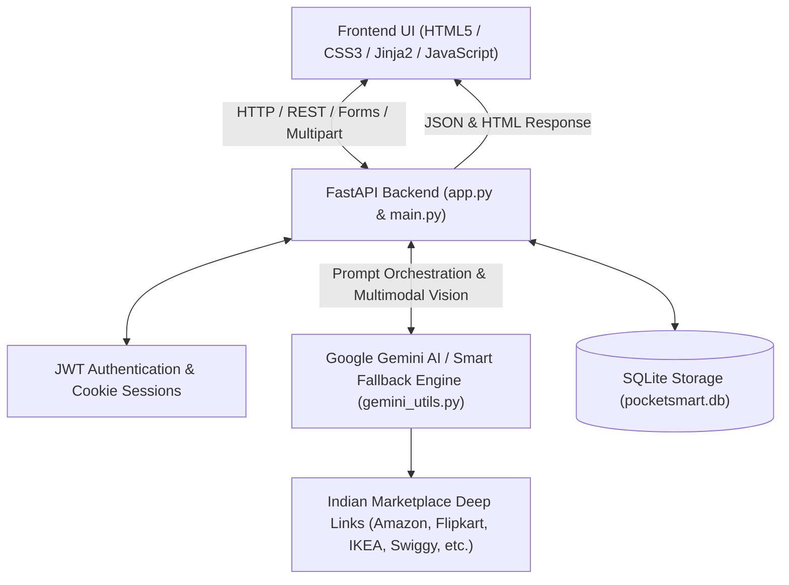

# PocketSmart AI: Your Smart Budget & Recommendation Assistant 💡💰

PocketSmart AI is an intelligent, multimodal budget planning and lifestyle recommendation platform designed to generate personalized, context-aware suggestions across **Home Interiors**, **Party Planning**, and **Jewelry Selection**.

Powered by **FastAPI** and **Google Gemini Generative AI**, PocketSmart AI transforms raw budget constraints into detailed breakdowns with live shopping links for top Indian platforms including Amazon, Flipkart, IKEA, Myntra, Ajio, Swiggy, Zomato, BookMyShow, Bluestone, and Tanishq.

---

## 🏗️ System Architecture



---

## 🌟 Key Features

1. **🏠 Home Interior Budget Planner**:
   - Custom budget allocation in INR for lights, ceiling fans, furniture, and dining tables.
   - Room-specific selection (Living Room, Kitchen, Bedroom).
   - Instant search links for Amazon India, Flipkart, IKEA India, Myntra, and Ajio.

2. **🎉 Party Budget Planner**:
   - Event budgeting for birthdays, weddings, anniversaries, reunions, and celebrations.
   - Custom guest counts, venue types, catering, decorations, and entertainment.
   - Venue booking recommendations with links to Google, Booking.com, MakeMyTrip, OYORooms, and NoBroker.
   - Food and catering links for Swiggy and Zomato.

3. **💍 Jewelry Budget Planner (Multimodal AI)**:
   - Budget planning based on occasion (wedding, festival, birthday, daily wear) and style preferences.
   - **Outfit Image Upload**: Multimodal vision analysis extracting outfit color palette, style, and formality.
   - Direct shopping links for Tanishq, CaratLane, BlueStone, Melorra, Meesho, Amazon, and Flipkart.

4. **🔒 Secure Authentication & Session Management**:
   - Encrypted passwords with `passlib` (Bcrypt).
   - JWT Access tokens issued via OAuth2 (`/token`) and seamless HTTP-only cookies.
   - Active session tracking and background cleanup of expired sessions.

5. **📜 Recommendation History & Modal Inspector**:
   - Automatically saves every budget plan to SQLite database.
   - Filter and review previous plans with one-click full breakdown modals.

6. **⚡ Resilient Smart Budget Engine (Zero-Failure Fallback)**:
   - Automatically provides intelligent, mathematical, context-aware allocations with real shopping links even if Google Gemini API quota is exhausted or offline.

---

## 📁 Project Structure

```
PocketSmart AI/
├── app.py                   # FastAPI Application, Routes, & Session Control
├── main.py                  # Entry Point for Uvicorn Server
├── gemini_utils.py          # Google Gemini AI Layer & Fallback Engine
├── models.py                # Pydantic Schemas & Data Models
├── database.py              # SQLite Persistence for Users & History
├── requirements.txt         # Python Dependencies
├── .env                     # Environment Configuration (API Keys & JWT)
├── .env.example             # Example Template for Environment Variables
├── run.bat                  # One-click Windows Batch Launcher
├── run.ps1                  # PowerShell Launch Script
├── README.md                # Project Documentation
├── static/
│   ├── styles.css           # Custom UI Styling matching Documentation
│   ├── images/              # Planner Card Images (Home, Party, Jewelry)
│   └── uploads/             # Uploaded Outfit Images
├── templates/
│   ├── index.html           # Landing Page with Features & Testimonials
│   ├── login.html           # User Login Page
│   ├── register.html        # User Registration Page
│   ├── dashboard.html       # User Dashboard with Active Planners
│   ├── home_planner.html    # Home Interior Budget Planner & Results
│   ├── party_planner.html   # Party Budget Planner & Results
│   ├── jewelry_planner.html # Jewelry Budget Planner (with Image Upload)
│   └── history.html         # Recommendation History & Details Modal
└── tests/
    └── test_app.py          # End-to-end Unit Tests (Pytest)
```

---

## 🚀 Quick Setup & Installation in VS Code

### 1. Prerequisites
- **Python 3.10+** (Python 3.11 recommended) installed on your system.
- **VS Code** with Python extension installed.

### 2. Open the Project
Open the project directory in VS Code:
```bash
File -> Open Folder -> Select "PocketSmart AI"
```

### 3. Automated Launch (Recommended)
Simply double click or run:
- On Windows Command Prompt:
  ```cmd
  run.bat
  ```
- On PowerShell:
  ```powershell
  .\run.ps1
  ```

---

### 4. Manual Setup Instructions

#### Step 4.1: Create & Activate Virtual Environment
```bash
python -m venv venv

# Windows (Command Prompt)
venv\Scripts\activate.bat

# Windows (PowerShell)
.\venv\Scripts\Activate.ps1
```

#### Step 4.2: Install Required Dependencies
```bash
pip install -r requirements.txt
```

#### Step 4.3: Configure `.env`
Ensure your `.env` contains your Gemini API key (or use the pre-configured one):
```ini
GEMINI_API_KEY=your_gemini_api_key_here
GOOGLE_API_KEY=your_gemini_api_key_here
GEMINI_MODEL=gemini-2.5-flash
SECRET_KEY=pocketsmart_super_secure_jwt_secret_key_2026_x89a!
ALGORITHM=HS256
ACCESS_TOKEN_EXPIRE_MINUTES=60
HOST=127.0.0.1
PORT=8000
```

#### Step 4.4: Start the Application
```bash
python app.py
```
*Alternatively, run with Uvicorn auto-reload:*
```bash
uvicorn app:app --reload --host 127.0.0.1 --port 8000
```

---

## 🌐 Accessing the Application

Open your browser and navigate to:
👉 **`http://127.0.0.1:8000`**

### Default Pre-configured User
- **Username**: `sai`
- **Password**: `password123`

*(You can also click **Get Started** or **Create Account** to register a new user anytime.)*

---

## 🧪 Running Unit Tests

Run the comprehensive test suite to verify all routes, authentications, budget generations, and persistence:
```bash
pytest tests/ -v
```

---

## 📡 API Endpoints Reference

| Method | Endpoint | Description |
|---|---|---|
| `GET` | `/` | Landing page |
| `GET` | `/login` | User login page |
| `POST` | `/login` | Authenticate user credentials & set session cookie |
| `GET` | `/register` | New user registration page |
| `POST` | `/register` | Register new user account |
| `POST` | `/token` | OAuth2 password request form token endpoint |
| `GET` | `/logout` | Invalidate token and clear user session |
| `GET` | `/dashboard` | User dashboard with planner cards & recent history |
| `GET` | `/home-planner` | Home Interior Planner page |
| `POST` | `/home-budget` | Generate Home budget recommendations via AI |
| `GET` | `/party-planner` | Party Budget Planner page |
| `POST` | `/party-budget` | Generate Party budget recommendations via AI |
| `GET` | `/jewelry-planner` | Jewelry Budget Planner page |
| `POST` | `/jewelry-budget` | Multimodal Jewelry recommendations (Text + Image) |
| `GET` | `/history` | View recommendation history page |
| `GET` | `/recommendation-history` | API returning past recommendations list |
| `GET` | `/recommendation-details/{id}` | API returning full details for a past plan |
| `GET` | `/session-info` | Metadata about current user session |
| `GET` | `/startup` | Health check & service status |

---

## 🏆 Project Achievements & Milestones

- ✅ **Milestone 1**: Gemini API initialization, multimodal vision setup, and environment verification.
- ✅ **Milestone 2**: Core AI prompt engineering, structured JSON parsing, and Indian marketplace integration.
- ✅ **Milestone 3**: FastAPI modular architecture, JWT token security, cookie handling, and SQLite history persistence.
- ✅ **Milestone 4**: Interactive HTML5/CSS3 frontend faithfully matching project design screenshots.
- ✅ **Milestone 5**: Full test coverage, budget accuracy validation, and smart fallback resilience.
